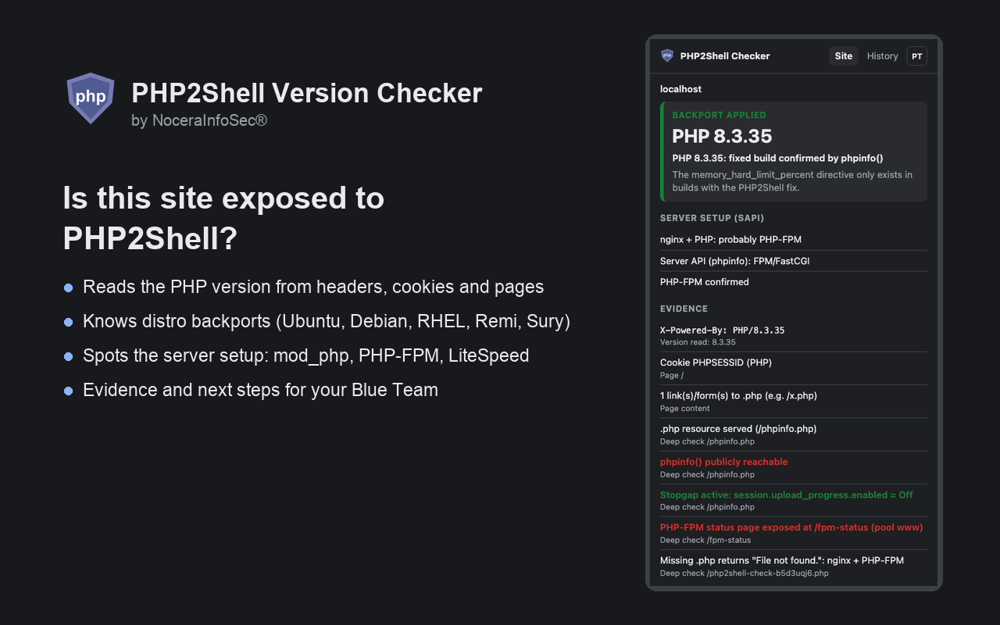
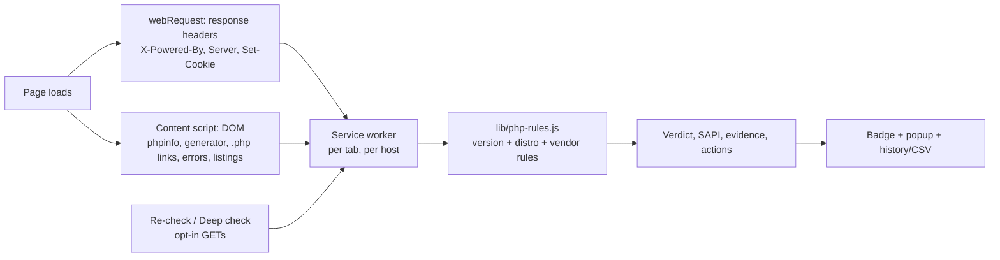
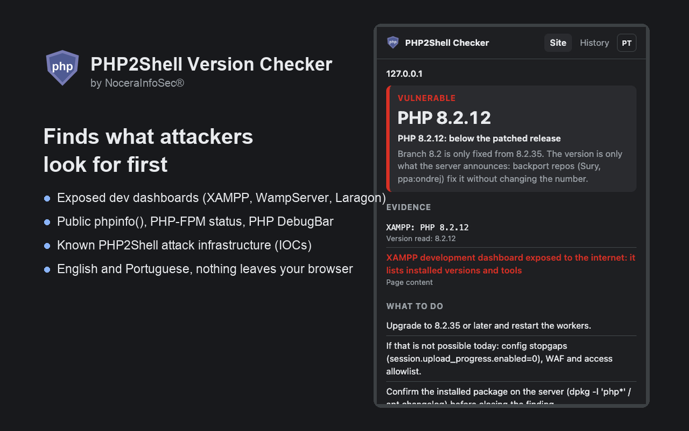
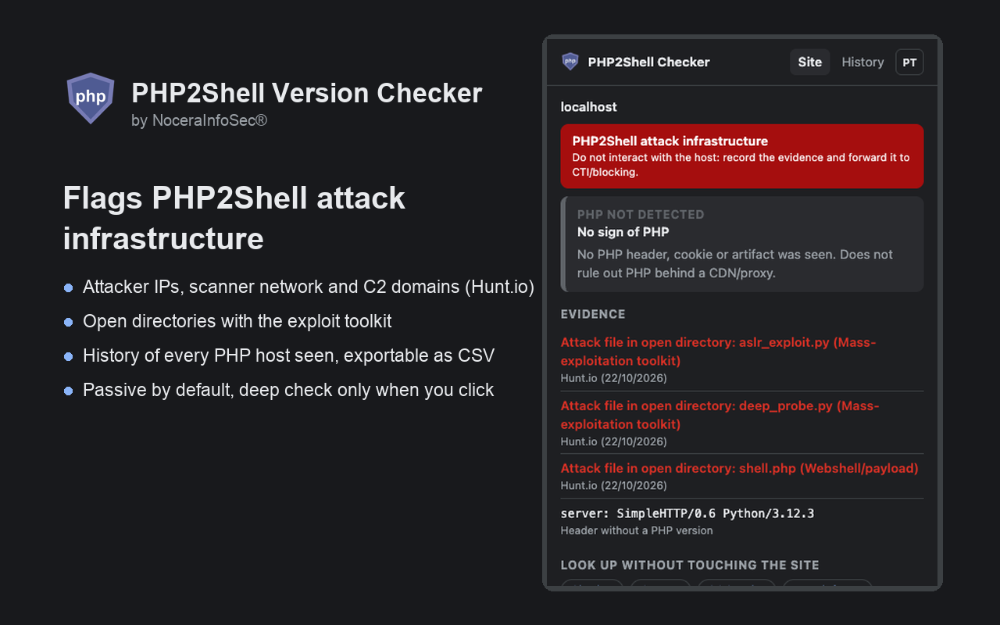

# PHP2Shell Version Checker

**A free Chrome extension for Blue Teams: see a site's PHP version and whether it is exposed to PHP2Shell
(CVE-2026-109618 / CVE-2026-109619), straight from the browser.**

By **NoceraInfoSec®** · [nocerainfosec.com.br](https://nocerainfosec.com.br) · [github.com/nocerainfosec](https://github.com/nocerainfosec) · MIT license

## Why

PHP2Shell is a pair of critical (CVSS 9.2) unauthenticated RCE bugs in PHP core, fixed on 21 Oct 2026 in
8.5.12, 8.4.27, 8.3.36 and 8.2.35. Generic tech-detection extensions show *a* PHP version but not what it means:

- Ubuntu, Debian, RHEL, Remi, cPanel, CloudLinux and Aikido ship the fix **without changing the version number**,
  so `PHP/8.1.2-1ubuntu2.28` is fixed while `PHP/8.1.2-1ubuntu2.14` is not.
- Release candidates such as `8.4.27RC1` look patched but are not.
- Many sites hide the version, and only cookies, paths or the server stack give PHP away.

This extension turns those details into a verdict, the evidence behind it, and what to do next.

## Install

1. Download this repository (**Code → Download ZIP**) and unzip it, or `git clone` it.
2. Open `chrome://extensions` and turn on **Developer mode**.
3. Click **Load unpacked** and select the folder.
4. Pin the icon. Reload tabs that were already open.

Works in Chrome, Edge, Brave and other Chromium browsers (Manifest V3). The interface is available in English and
Portuguese: it follows the browser language and can be switched with the **PT/EN** button in the popup.

## How to use

- **Just browse.** The icon badge shows the PHP branch (e.g. `8.3`) in the verdict colour:
  red = vulnerable/EOL, orange = confirm backport, green = patched/backport, grey = PHP without a version,
  `IOC` = known attack infrastructure.
- **Click the icon** for the verdict, server setup (SAPI), evidence, recommended actions, other PHP hosts
  loaded by the page (APIs, CDNs) and one-click lookups on Shodan, Censys and public PHP2Shell checkers.
- **Re-check** sends two plain GETs (`/` and `/index.php`) without cookies, for pages served from cache or
  opened before the extension was installed.
- **Deep check** (asks for a second click) sends about 15 GETs to well-known public paths. No exploit traffic,
  but it can show up in a WAF: **use it only on assets you are authorized to test**.
- **Copy report** produces ticket-ready text. **History** keeps every PHP host seen and exports CSV for inventory.

## How it works

### 1. Passive collection (always on)

Nothing extra is sent to the site. The extension reads what the browser already received:

| Source | What it looks for |
|---|---|
| `X-Powered-By`, `Server` | Version strings: `PHP/8.1.2-1ubuntu2.14`, `Apache/2.4 (Ubuntu) PHP/8.0.30` |
| `X-Powered-By` without a version | `php`, `ThinkPHP`, `FrankenPHP`, PHP frameworks (`Fat-Free Framework`, `Nette`, `Craft CMS`…) |
| `Set-Cookie` (including HttpOnly) | `PHPSESSID`, `laravel_session`, `XSRF-TOKEN` + `<app>_session` (Laravel), `ci_session`, Drupal `SESS…`, Nextcloud/ownCloud, `zbx_session`, Cacti, `WHMCS…` and others |
| Other headers | `X-PHP-PID`, `X-PHP-Response-Code`, `X-Pingback`, `X-Generator`, `X-Drupal-Cache`, `X-Magento-*`, WordPress `Link` |
| Page content | A public `phpinfo()` page, Apache's `<address>` signature (`Apache/2.4 … PHP/7.2.18 Server at …`), `<meta name="generator">` for PHP CMSs and WordPress plugins, `wp-content`, `.php` links, PHP error messages |
| Exposed dev dashboards | WampServer, Laragon, XAMPP, MAMP homepages: flagged as a finding, and their PHP version is used when headers give none |
| Security findings | PHP DebugBar enabled in production (`phpdebugbar-id`), public `phpinfo()`, PHP-FPM status page |
| Every host the page loads | APIs and asset hosts are rated separately ("other hosts") |
| Attack signal | `PHPSESSID` with an abnormally large value, a PHP2Shell exploitation sign |

### 2. Version rules (`lib/php-rules.js`)

| Verdict | When |
|---|---|
| **VULNERABLE** | 8.5 < 8.5.12, 8.4 < 8.4.27, 8.3 < 8.3.36, 8.2 < 8.2.35; RC builds; distro or Sury packages older than the known fixed package |
| **UNSUPPORTED (EOL)** | 8.1 and older, with no sign of a vendor build |
| **CONFIRM BACKPORT** | Distro package without a mapped advisory; last EOL releases that vendors patch silently (7.4.33, 8.0.30, 8.1.34…); Sury revisions reported as fixed |
| **BACKPORT APPLIED** | Known fixed packages: Ubuntu 26.10/26.04/24.04/22.04/20.04 ESM, Debian 12/13; or a `phpinfo()` showing `memory_hard_limit_percent` |
| **PATCHED VERSION** | Announced version at or above the fixed release |
| **PHP, NO VERSION** | PHP is present but the version is hidden (`expose_php=Off`) |

Known fixed packages and vendor builds:

| Vendor | Fixed package | Advisory |
|---|---|---|
| Ubuntu 26.10 / 26.04 / 24.04 / 22.04 | `8.5.9-0ubuntu2.1` / `8.5.4-0ubuntu1.5` / `8.3.6-0ubuntu0.24.04.13` / `8.1.2-1ubuntu2.28` | USN-8948-1 |
| Ubuntu 20.04 (ESM) | `7.4.3-4ubuntu2.29+esm5` | USN-8948-2 |
| Debian 13 / 12 | `8.4.27-1~deb13u1` / `8.2.35-1~deb12u1` | DSA-6574-1, DLA-4848-1 |
| RHEL 8/9/10, Rocky | 8.2.35, 8.3.36, 8.4.27; php:7.4 `7.4.33-8`; RHEL 9 php `8.0.30-8.el9_8.1` | RHSA-2026:87070–87151 |
| Remi | `7.4.33-31`, `8.0.30-21`, `8.1.34-6` | |
| Sury / ppa:ondrej | `5.6.40-104` … `8.1.34-9` (unofficial report) | |
| Aikido images | `php:8.4.26`, `php:8.3.35`… tags already include the fix | |

### 3. Server setup (SAPI)

PHP rates **Apache + mod_php** as the highest-risk setup. The extension infers the SAPI from:

- `PHP/x.y.z` inside the `Server` header → mod_php
- `Server: nginx` + PHP → probably PHP-FPM; `LiteSpeed` → lsphp; `Caddy` + PHP → probably FrankenPHP
- Deep check: `Server API` from `phpinfo()`, the FPM status page, or the `File not found.` answer that nginx + FPM
  gives for a missing `.php`

### 4. Deep check (opt-in)

| Request | Why |
|---|---|
| `/phpinfo.php`, `/info.php`, `/test.php`, `/i.php`, `/php.php`, `/pi.php`, `/php_info.php`, `/_profiler/phpinfo` | Exposed `phpinfo()`: exact version, SAPI, `session.upload_progress.enabled` (the official stopgap) and `memory_hard_limit_percent`, a directive that only exists in fixed builds |
| `/fpm-status`, `/status`, `/php-status`, `/php-fpm-status` | Exposed PHP-FPM status page (confirms FPM and is a finding by itself) |
| `/server-status` | Apache mod_status, which may list `PHP/x.y.z` |
| `/php2shell-check-<random>.php` | How the server answers a missing PHP file reveals nginx + FPM or FastCGI/CGI |
| `/?=PHPE9568F34-D428-11d2-A769-00AA001ACF42` | The PHP logo easter egg only answers on PHP older than 5.5 |

It stops at the first hit in each group, never sends cookies and never sends a request body.

### 5. Attack infrastructure (IOC)

From Hunt.io's research on attacker open directories, the badge shows `IOC` and a red banner when:

- the host is a listed scanner, payload, botnet or staging IP, the `45.198.224.0/24` scanner network, or a C2 domain;
- the page is a directory listing that contains PHP2Shell toolkit files (`aslr_exploit.py`, `deep_probe.py`,
  `c2.py`, `probe_rfc1867.py`, `verify_fixation.py`, `autologin_fd.php`, `tebaran_*`).

## Limitations

- The version is only what the server **claims**. It can be hidden, belong to another node behind a load
  balancer, or be patched by a vendor without changing the number. **Only the version and package installed on
  the server are conclusive** (`php -v`, `php-fpm -v`, `dpkg -l 'php*'`, `rpm -qa 'php*'`, package changelogs).
- A patched version does not prove the workers were restarted.
- "PHP not detected" does not rule out PHP behind a CDN or reverse proxy.
- This is not an exploit or vulnerability scanner and does not replace server-side checks or tools such as Nuclei.

## Development

- Rules and indicators: `lib/php-rules.js` (`FIXED`, `DISTRO_FIXED`, `SURY_FIXED`, `VENDOR_BACKPORTS`, `IOC_*`).
- Translations: `lib/i18n.js` (every message exists in English and Portuguese).
- Tests: `node --test tests/*.test.mjs` (Node 20+).
- QA with real data: `node tools/shodan-qa.mjs <shodan-export.json.gz>` runs every HTTP banner of a Shodan export
  through the same rules and reports verdicts, parser gaps, unmapped distro packages, agreement with Shodan's own
  PHP CPE, phpinfo() pages, exposed dev dashboards and IOC hits. Banners Shodan tags as honeypots are skipped by
  default (`--include-honeypots` to keep them): they imitate dozens of products at once and skew the numbers.
  On a 10,000-banner sample (8,983 after removing honeypots) it read a PHP version on 98.4% of hosts and agreed
  with Shodan's own PHP CPE on 8,584 of 8,588. Keep exports and evidence out of git (`samples/` and `evidences/`
  are ignored).
- After changing rules, bump `RULES_VERSION` and reload the extension in `chrome://extensions`.

Pull requests with new advisories, distro packages or detection signals are welcome. Please cite the source.

## Sources

- [Hunt.io: Hunting Leaked PHP2Shell RCE Across Open Directories](https://hunt.io/blog/php2shell-cve-2026-109618-109619-open-directories)
- [Brandefense: PHP2Shell fixed PHP versions](https://brandefense.io/blog/php2shell-php-rce-cve-2026-109618-109619/)
- [ComputingForGeeks: PHP2Shell check and patch](https://computingforgeeks.com/php2shell-cve-2026-109618-check-patch/)
- [Aikido: PHP2Shell patches and free images](https://www.aikido.dev/blog/critical-vulnerabilities-in-php-php2shell)
- [watchTowr: PHP2Shell FAQ](https://watchtowr.com/intelligence/php-cve-2026-109618-faq/)
- [SOCRadar: PHP2Shell affected versions](https://socradar.io/blog/php2shell-cve-2026-109618-cve-2026-109619/)
- [Prophet Security: detecting and investigating PHP2Shell](https://www.prophetsecurity.ai/blog/php2shell)
- [PHP Watch: PHP easter eggs](https://php.watch/articles/php-easter-eggs)

---

## Author

**Guilherme Nocera / NoceraInfoSec®**, Purple Team and Offensive Security Researcher

- Website: [nocerainfosec.com.br](https://nocerainfosec.com.br)
- GitHub: [github.com/nocerainfosec](https://github.com/nocerainfosec)

MIT © 2026 Guilherme Nocera / NoceraInfoSec®. NoceraInfoSec® is a registered trademark; the license covers the
code only.
